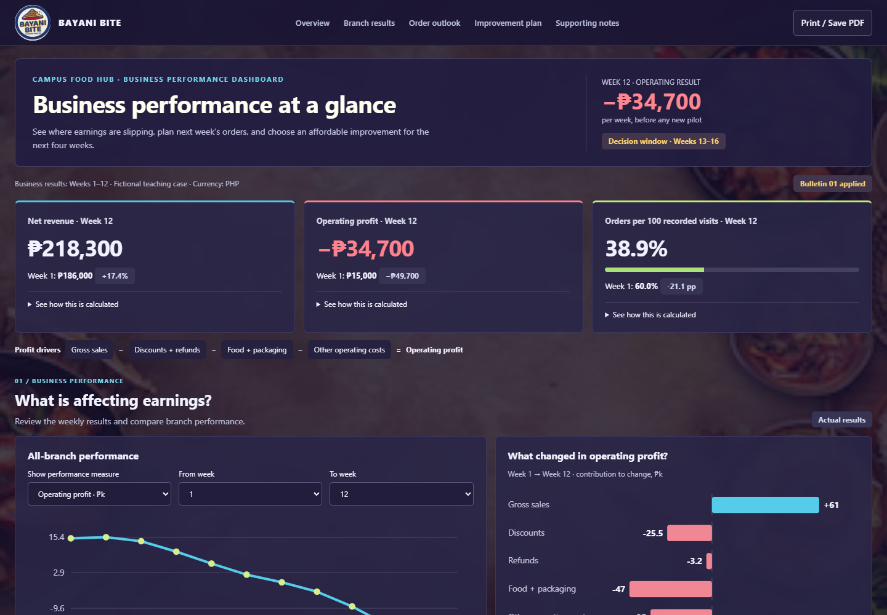

# BAYANI BITE · Business Performance Dashboard

Interactive, offline executive dashboard and decision support system for **Bayani Bite** (Campus Food Hub).



## Overview

- **Standalone Single-File Application**: Run [BAYANI_BITE_Dashboard.html](BAYANI_BITE_Dashboard/BAYANI_BITE_Dashboard.html) directly in any modern web browser (Edge, Chrome, Safari, Firefox). No servers, node modules, or internet access required.
- **Translucent Filipino Food Background**: Custom warm parchment and traditional Filipino culinary framing.
- **Embedded Source Data**: All 5 historical and pilot CSV datasets are embedded with independent KPI, pilot, survey, and ledger reconciliations.
- **Planning & Scenario Modeling**: Includes Board Bulletin 01 updates, option comparisons (A–E), budget thresholds, and 4-week incremental profit impact calculations.

## Quick Start

1. Open `BAYANI_BITE_Dashboard/BAYANI_BITE_Dashboard.html` in your browser.
2. Select timeframes and branch locations (North Gate, Library Walk, South Quad) to inspect operating metrics.
3. Explore interventions A through E under the updated Bulletin 01 scenario (₱27k budget).
4. Download state snapshots or export for reporting and analysis.

## Project Structure

```
├── BAYANI_BITE_Dashboard/
│   ├── BAYANI_BITE_Dashboard.html   # Main interactive standalone dashboard
│   ├── background.png               # Translucent food & parchment background
│   ├── Dashboard_Overview.png       # Desktop overview preview
│   ├── Dashboard_Pilot.png          # Pilot option calculator preview
│   ├── Dashboard_Full.png           # Complete dashboard view
│   ├── Dashboard_Mobile.png         # Mobile layout view
│   └── START_HERE.txt               # User instructions & checklist
├── BAYANI_BITE_Source_Data_CSV/     # Official CSV source exhibits
├── build_dashboard.py               # Build & verification script
├── test_dashboard.cjs               # Playwright automated test & screenshot suite
├── Canvas_Bulletin.html             # Board Bulletin 01 guidance
└── dashboard.template.html          # HTML dashboard source template
```
